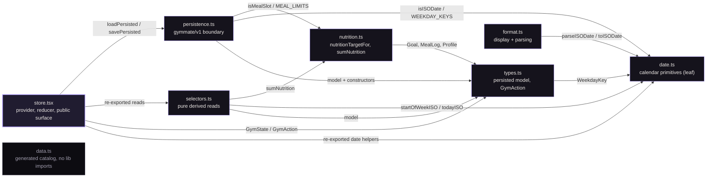

<div align="center">

# GymMate

*A dark-only strength, cardio and nutrition tracker that keeps every byte on your device.*


[](LICENSE)


[Quick start](#quick-start) · [Structure](#project-structure) · [Scripts](#scripts) · [Docs](#docs) · [Credits](#data-and-credits)

</div>

## What it is

GymMate is a personal training log for one person: your lifts, your cardio, your bodyweight
and your meals, recorded on your own device. There is no account, no cloud and no telemetry;
state lives in AsyncStorage under `gymmate/v1` and nowhere else. The app is five tabs — Today,
Plan, Cardio, Progress and You — plus a full-screen `/nutrition` route opened from Today and
You. A first-run `/onboarding` flow collects a name, current and target weight, and one
lose-or-gain goal; `RouteGate` keeps a profile-less install on that flow.

## Features

| Area | What it does |
| --- | --- |
| **Today** | Greets you by name, shows today's scheduled session and logs it as sets × reps × kg. Streak, week volume, weekly cardio distance and current weight are derived from what you logged, and a nutrition card opens `/nutrition`. |
| **Plan** | The schedule builder. You name each day, mark it training or rest, and add or remove real lifts from the catalog. A new schedule starts empty; the app never prescribes a program. |
| **Cardio** | Logs runs in kilometres and minutes and derives pace from them, with this week's kilometres shown per day. |
| **Progress** | Bodyweight log, trend sparkline and progress toward the target weight, in the direction set by the profile goal. |
| **Nutrition** | Daily calorie and macro targets derived from the profile goal and the latest weigh-in, meals in four slots, and a seven-day chart. |
| **Exercise library** | 1,324 catalog entries, each with a bundled 180×180 WebP still; the 137 featured lifts also carry an animated WebP. Metadata is present only where it is known — 1,045 entries name a muscle group — and an absent value is never replaced with a default. |
| **Persistence** | One `gymmate/v1` blob, hydrated once. A failed or corrupt read is copied to `gymmate/v1.corrupt` and leaves the session read-only, so a bad read cannot overwrite good data. |
| **Design** | Dark only, one lavender accent, tokens from `constants/GymMateTheme.ts`. There is no light mode and no second palette. |

## Screens

| Screen | Route | What it is |
| --- | --- | --- |
| **Today** | `app/(tabs)/index.tsx` | The front door: today's plan, the log action, and the week at a glance. |
| **Plan** | `app/(tabs)/workouts.tsx` | The week you build: named days, training or rest, lifts from the catalog. |
| **Cardio** | `app/(tabs)/cardio.tsx` | Runs with distance, duration and derived pace. |
| **Progress** | `app/(tabs)/progress.tsx` | Weigh-ins, the trend and the distance left to the target. |
| **You** | `app/(tabs)/you.tsx` | Profile, lifetime numbers, the media credit, edit profile and reset. |
| **Nutrition** | `app/nutrition.tsx` | Root-stack route, not a tab: targets, meals and the seven-day chart. |
| **Onboarding** | `app/onboarding.tsx` | First run, and `?edit=1` to edit an existing profile. |

## Quick start

```bash
pnpm install
pnpm start
```

Metro then serves all three targets: press `a` for Android, `i` for iOS or `w` for web.

On this Windows machine the execution policy restricts a bare `pnpm exec`, so commands run
through an explicit bypass — the same wrapper applies to the dev server:

```powershell
powershell -ExecutionPolicy Bypass -Command "pnpm start"
```

A new native module needs a dev build — `expo run:android`, `expo run:ios` or
`eas build --profile development` — because Expo Go cannot load it.

## Project structure

```text
GymMate/
├── app/                 Expo Router routes only
├── components/gymmate/  route-agnostic design system, no store access
├── lib/gymmate/         the domain, as one module graph
├── constants/           theme tokens and the layout-width contract
├── hooks/               shared hooks
├── scripts/             catalog check, size report, media tooling
└── assets/              fonts, images and the bundled exercise media
```

`lib/gymmate/` is split by responsibility, and every consumer still imports the domain from
`@/lib/gymmate/store`:

| Module | Owns |
| --- | --- |
| `types.ts` | The persisted model (`GymState`, `PersistedState`, `GymAction`) and `makeEmptySchedule`. |
| `persistence.ts` | The `gymmate/v1` boundary: `loadPersisted`, `savePersisted`, validation and the corrupt-blob backup. |
| `selectors.ts` | Pure derived reads — streaks, weekly volume, nutrition totals. |
| `store.tsx` | Context, reducer and the re-exported public surface. |
| `date.ts` | Calendar primitives; a leaf that imports nothing. |
| `format.ts` | Display formatters and input parsing. |
| `nutrition.ts` | Target and macro maths: `nutritionTargetFor`, `sumNutrition`. |
| `data.ts` | The generated 1,324-entry exercise catalog and its search and lookup helpers. |

## Architecture

Arrows point at the dependency, so `store.tsx` sits at the dependent end and `date.ts` at the
leaf. Nothing in `lib/gymmate/` imports `store.tsx`, which keeps the graph acyclic and hydration
order predictable.



## Theme

| Token | Role | Value |
| --- | --- | --- |
| `bg` | App and screen background |  |
| `surface` | Cards and panels |  |
| `surface2` | Nested and framed surfaces |  |
| `line` | Hairline borders and dividers |  |
| `accent` | Active tab, focus, primary fills |  |
| `accentInk` | Text and glyphs on an accent fill |  |
| `ink` | Primary text |  |
| `muted` | Secondary and quiet text |  |
| `label` | Field labels and lead copy |  |
| `danger` | Destructive text and icons |  |
| `success` | Positive confirmation |  |
| `goalLose` | Lose-weight goal accent |  |
| `goalGain` | Gain-weight goal accent |  |

`constants/GymMateTheme.ts` is the single source of truth for these values and the only
`.ts`/`.tsx` file allowed to hold a hex value; the sole other exception is the raw CSS in the
web shell `app/+html.tsx`.

## Scripts

| Script | What it does |
| --- | --- |
| `pnpm start` | Metro dev server for Android, iOS and web. |
| `pnpm android` | Dev server opened on Android. |
| `pnpm ios` | Dev server opened on iOS. |
| `pnpm web` | Dev server opened on web. |
| `pnpm typecheck` | `tsc --noEmit` under strict TypeScript. |
| `pnpm lint` | ESLint flat config with the icon-barrel, inline-hex and `any` rules. |
| `pnpm format` | Prettier write. |
| `pnpm format:check` | Prettier verify. |
| `pnpm check:catalog` | Exercise catalog and media invariants. |
| `pnpm size:report` | Export size per platform, checked against `size-budget.json`. |

## Docs

| Document | Contents |
| --- | --- |
| [`PRODUCT.md`](PRODUCT.md) | The product authority: what GymMate is, the core loop and the non-negotiable rules. |
| [`DESIGN.md`](DESIGN.md) | The visual system: tokens, layout widths, typography, components, accessibility and motion. |
| [`AGENTS.md`](AGENTS.md) | Engineering rules: stack discipline, project structure, conventions, navigation and EAS. |
| [`SIZE.md`](SIZE.md) | The measured bundle report and its guardrails. |

## Data and credits

Exercise metadata comes from [`yuhonas/free-exercise-db`](https://github.com/yuhonas/free-exercise-db),
released under the Unlicense. The bundled WebP stills and animations are © Gym visual —
https://gymvisual.com/, capped at 180×180, with the credit line rendered in the exercise detail
sheet and on the You screen. The full terms are a product rule in [`PRODUCT.md`](PRODUCT.md).

## Privacy

Everything stays on-device in AsyncStorage under `gymmate/v1`. There are no accounts, no network
calls and no telemetry; a failed read is preserved under `gymmate/v1.corrupt` rather than
overwritten.

## Licence

MIT © 2026 Hamouche — see [`LICENSE`](LICENSE).
